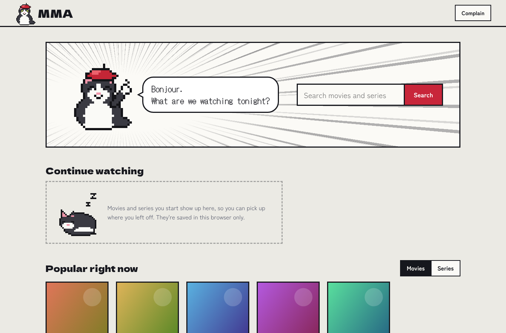
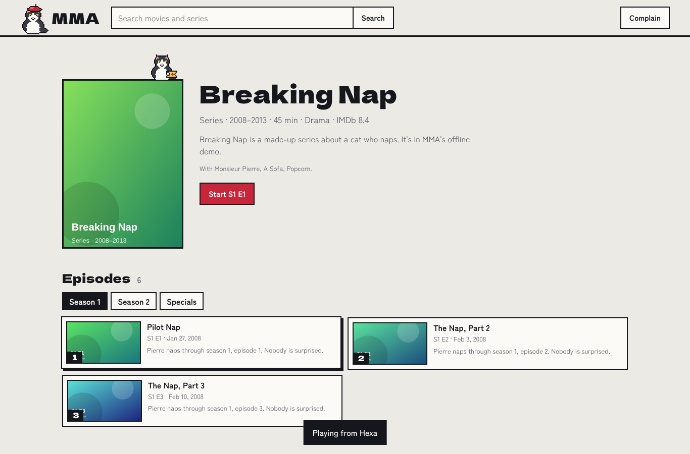
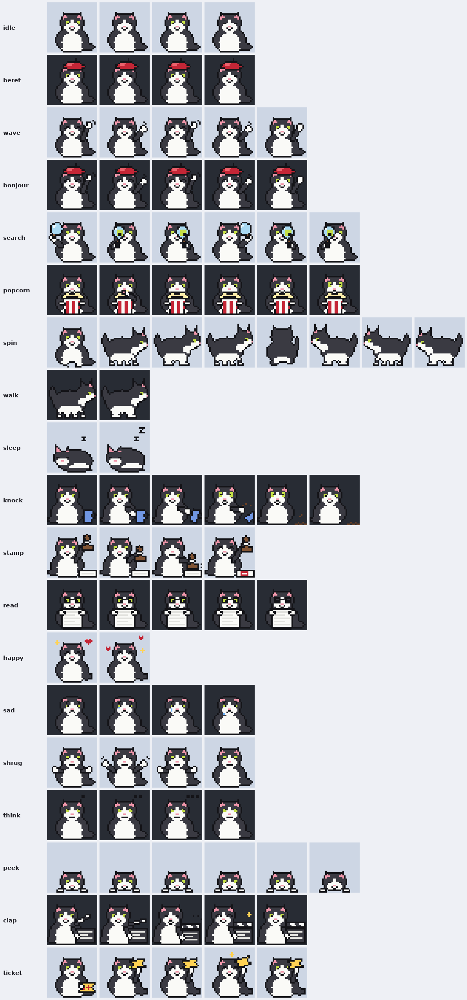

<p align="center"></p>

# MMA: Monsieur Pierre's mov-cli

A web GUI for movies and series, in the spirit of [mov-cli](https://github.com/mov-cli/mov-cli), that runs on GitHub Pages. You open the site, search, pick a movie or an episode and watch it. No accounts, no install. It's the movie sibling of [MPA](https://github.com/lolesterrr/MPA-monsieur-pierre-aniCLI-), with the same UI and the same lazy tuxedo cat, Monsieur Pierre from [oneko-woah](https://github.com/lolesterrr/oneko-woah), who now also works a clapperboard.

<p align="center">
  
  
</p>

## How it works

GitHub Pages only serves files, so MMA splits the job in three:

```
your browser  ──>  MMA site (GitHub Pages, the web/ folder)
      │
      ├──────────> Cinemeta (Stremio's public catalog): search, posters, seasons and episodes
      │
      └──────────> MMA worker (Cloudflare, the worker/ folder)  ──>  the stream sources
```

The catalog is public and answers browsers directly, so searching costs the worker nothing. The worker steps in when you press play. It asks the stream sources for a link, in this order:

| Server | Has | How |
| --- | --- | --- |
| Videasy | movies and series, up to 4K | encrypted, decrypted by [enc-dec.app](https://enc-dec.app); the stream host wants Videasy's Referer, so the worker relays it |
| LookMovie | movies, lots of subtitles | a plain JSON API; local helper only (its links are tied to the machine that asked) |
| Hexa | movies (series sometimes) | encrypted like Videasy; the stream is open, so the browser plays it directly and the worker isn't used for the video |
| VidLink | movies and series, some episodes the others lack | its id comes from enc-dec.app; plain MP4 files (MovieBox's) that only load with MovieBox's app User-Agent, so the worker relays them. Some copies are HEVC (H.265), which plays in Edge and Safari, and in Chrome when the graphics chip does HEVC |

If one has nothing, the next one gets asked. You can also pick a server on the watch page. Subtitles from [OpenSubtitles](https://www.opensubtitles.org) (through Stremio's add-on) are added to whatever the server has.

Relay links are signed and expire, so the worker can't be used as an open proxy.

### Why not mov-cli itself?

mov-cli is a framework without scrapers of its own: the scraping lives in plugins. mov-cli and its main movie plugin ([film-central](https://github.com/JDALab/film-central)) are no longer maintained, and their sources are gone. So is flixhq, which [lobster](https://github.com/justchokingaround/lobster) used, since its backend went down in April 2026. MMA follows the references that are still alive instead: the [enc-dec.app samples](https://github.com/smy778/EncDecEndpoints) and [StreamViva's providers](https://github.com/loak7993-code/streamviva-providers).

## Setup (about five minutes)

### 1. Deploy the worker

You need a free [Cloudflare](https://dash.cloudflare.com/sign-up) account. If you already run MPA's worker, use the same account and make a second worker next to it.

**From the dashboard, no tools needed**

1. In the Cloudflare dashboard, go to Workers & Pages and create a new Worker from the "Hello World" starter. Name it `mma` and deploy it.
2. Open the worker, choose **Edit code**, replace everything with the contents of [`worker/dist/mma-worker.js`](worker/dist/mma-worker.js) (the file that starts with `// MMA worker, single file`) and deploy again.
3. In the worker's **Settings > Variables and Secrets**, add:
   - `SIGNING_KEY`, type **Secret**: any long random string. Required: it signs the video relay links.
   - `ALLOWED_ORIGINS`, type **Text**: `https://lolesterrr.github.io`. Optional: without it, any website can use your worker.
4. Copy the worker's address. It looks like `https://mma.your-name.workers.dev`.

**Or with Wrangler**

```sh
cd worker
npx wrangler@4 login
npx wrangler@4 deploy
npx wrangler@4 secret put SIGNING_KEY
```

`wrangler.toml` already sets `ALLOWED_ORIGINS` and `GITHUB_REPO`.

### 2. Point the site at the worker

Put the worker's address in [`web/config.js`](web/config.js):

```js
window.MMA_CONFIG = {
  api: "https://mma.your-name.workers.dev",
  repo: "lolesterrr/MMA-monsieur-pierre-mov-cli-",
  catalog: "https://v3-cinemeta.strem.io",
};
```

Until you do, the site shows a setup screen where you can paste the address for your own browser.

### 3. Turn on GitHub Pages

In the repo: **Settings > Pages > Build and deployment > Source: GitHub Actions**. The [Pages workflow](.github/workflows/pages.yml) publishes `web/` on every push that touches it. The site lives at <https://lolesterrr.github.io/MMA-monsieur-pierre-mov-cli-/>.

### 4. Check it

Scroll to the bottom of the site, open **Backstage** and press **Check the connection**. You want green squares for the worker, the video relay, the catalog and at least one server. Or run **Actions > Check the worker > Run workflow**, which plays a movie through the worker all the way to a video segment and tells you what it costs.

### Optional: let the complaint desk file issues itself

Every page has a **Complain** button. Without extra setup, a complaint opens a GitHub "new issue" page with everything filled in, so the person needs a GitHub account to send it. To have the worker file complaints directly, as issues labelled `complaint`:

1. On GitHub: Settings > Developer settings > Personal access tokens > **Fine-grained tokens** > Generate new token.
2. Repository access: only this repo. Permissions: **Issues: Read and write**. Nothing else.
3. Add it to the worker as a secret named `GITHUB_TOKEN`.

Complaints are public issues, and the desk says so. It attaches the page, the title, the episode, the server, the last error and the browser, and shows exactly what it attaches before sending.

### Optional: deploy the worker from GitHub

The [Worker workflow](.github/workflows/worker.yml) redeploys the worker whenever `worker/` changes, once you add two repo secrets: `CLOUDFLARE_API_TOKEN` (made from the "Edit Cloudflare Workers" template) and `CLOUDFLARE_ACCOUNT_ID`.

## The Deno helper: for sources that refuse Cloudflare

Videasy and LookMovie refuse to hand links to Cloudflare's servers (Hexa doesn't mind). Videasy's video is fine going through Cloudflare, only the lookup gets refused. So [`deno/main.js`](deno/main.js) runs the same lookup code on [Deno Deploy](https://deno.com/deploy), which isn't Cloudflare, and hands back links that still play through the Cloudflare worker. A lookup is a few kilobytes, so Deno's free plan (1M requests and 20 GB a month) is far more than enough. The video never touches Deno.

The site asks the worker first. When the worker comes back with nothing, it asks the helper.

1. Go to [console.deno.com](https://console.deno.com), sign in with GitHub and make an organization.
2. **+ New App**, pick this repo. Under **Edit build config**: Framework preset **No Preset**, install and build commands empty, Runtime **Dynamic**, Dynamic Entrypoint `deno/main.js`.
3. **Add/Edit environment variables**:
   - `SIGNING_KEY`, secret: **the same value as the Cloudflare worker's**. That's how the worker knows the helper's links are real.
   - `RELAY_ORIGIN`: the worker's address, `https://mma.your-name.workers.dev`
   - `ALLOWED_ORIGINS`: `https://lolesterrr.github.io`
4. **Create App**, copy its address and put it in `web/config.js` as `lookup`.

Backstage then shows a "Deno helper" row, and the player says "found by the Deno helper" when it was the one that found the link. The helper tries Videasy and Hexa only (`SERVERS`). LookMovie refuses Cloudflare, and its links only work from the machine that asked for them (anyone else gets "WRONG HASH!"), so it only works through the local helper, where your computer does both.

## If a source won't talk to Cloudflare

Some sites turn away requests from Cloudflare's servers, or the worker runs out of free requests for the day. The local helper is the same worker code running on your computer, with video going through your own connection:

```sh
node local/server.mjs                 # then open http://localhost:8787
HOST=0.0.0.0 node local/server.mjs    # also reachable from your phone on the same Wi-Fi
```

It needs Node.js 20 or newer and checks every server when it starts. To use the GitHub Pages site with it, set the worker address in Backstage to `http://localhost:8787`.

## What's in it

- Search movies and series together, with posters and a movies/series filter
- Popular movies and series on the home page
- Series pages with season tabs, specials, episode names, thumbnails and air dates; episodes that aren't out yet are marked
- Player with server switching, quality switching (it won't start in 4K unless you ask), subtitles in dozens of languages, resume where you stopped, and the next episode after a countdown
- Continue watching on the home page, kept in this browser only, and it remembers the server you picked for each title
- "Other players": copy the stream link for mpv or VLC, or open it in IINA on a Mac
- Complaint desk on every page, with report buttons on every error
- Light and dark themes, works on phones, keyboard friendly, respects reduced motion
- No accounts and no trackers. Fonts and the video player are bundled with the site

## Monsieur Pierre

Pierre's sprites come from MPA: [`tools/makepierre.py`](tools/makepierre.py) is the original from oneko-woah and [`tools/makepierre_mpa.py`](tools/makepierre_mpa.py) is MPA's 17 animations. [`tools/makepierre_mma.py`](tools/makepierre_mma.py) adds two for the cinema, with the same 32×32 frames, palette and outline pass.

<p align="center"></p>

| Animation | Where he does it |
| --- | --- |
| `clap` | Snapping the clapperboard while a stream is found; the share image |
| `ticket` | Sitting on the poster on a movie or series page |
| `bonjour`, `beret` | Home page, logo |
| `search` | Looking up a search |
| `think` | Backstage |
| `popcorn`, `peek`, `sleep` | Sitting on the player: watching, paused, paused for a long time |
| `knock` | Errors (yes, that's your mug) |
| `sad`, `shrug` | Nothing found, no server has it |
| `read`, `stamp`, `happy` | Complaint desk: reading, filing, done |
| `idle`, `wave`, `walk`, `spin` | Spares |

Click Pierre on the home page, on a poster or on the player for a joke. Rebuild the sheet after changing him: `npm run sprites` (needs Pillow).

## Limits

- Cloudflare's free plan allows 100,000 worker requests a day, shared by every worker on the account (MPA's too). Every relayed video segment is a request: a 2 hour movie on Videasy is about 1,200, a 45 minute episode about 460. Hexa streams usually skip the worker entirely. The **Check the worker** workflow prints the numbers for any title.
- New releases often take a few days to reach the servers.
- Stream links expire after a few hours. If you pause for longer, MMA fetches fresh ones and carries on.
- Servers come and go. The **Check the sources** workflow runs every Monday against the real sites and goes red when one breaks.

## Development

```sh
npm test          # worker tests against fake sources (needs ffmpeg)
npm run demo      # the whole app offline on http://127.0.0.1:8787, with made-up titles
npm run e2e       # clicks through the demo in Chromium (needs Playwright; run the demo with FAKE_CODEC=vp9)
npm run live      # the worker code against the real sources (needs internet that can reach them)
npm run build     # rebuild worker/dist/mma-worker.js after editing worker/core.js
```

The site is plain HTML, CSS and JavaScript modules with no build step. The worker has no dependencies.

### When a source breaks

Run **Actions > Check the sources** to see which one. Then compare `worker/core.js` with the matching sample in [EncDecEndpoints](https://github.com/smy778/EncDecEndpoints/tree/main/samples) (videasy.py, hexa.py) or the source in [streamviva-providers](https://github.com/loak7993-code/streamviva-providers/tree/production/src/providers/sources) (lookmovie), port the change, update the fake in `test/fake-sources.mjs` if the shapes changed, and run `npm run build`. To take a server out of rotation without a code change, set the worker's `SERVERS` variable, e.g. `videasy,hexa`.

## Layout

```
web/       the site (GitHub Pages serves this folder)
worker/    core.js (sources and relay), worker.js (Cloudflare entry), dist/ (single-file copy)
deno/      the lookup helper for Deno Deploy
local/     the local helper
tools/     Pierre's sprite generators, the worker bundler, the live source check
test/      fake sources, worker tests, browser test, offline demo
```

## Credits and license

MMA is GPL-3.0, like MPA, which most of its code comes from. Source steps follow the [EncDecEndpoints](https://github.com/smy778/EncDecEndpoints) samples (MIT) and [streamviva-providers](https://github.com/loak7993-code/streamviva-providers) (MIT). The catalog is Stremio's [Cinemeta](https://v3-cinemeta.strem.io). The sprite generator comes from oneko-swift (MIT), the player is [hls.js](https://github.com/video-dev/hls.js) (Apache-2.0), and the fonts are Dela Gothic One, DotGothic16 and Zen Kaku Gothic New (SIL Open Font License). See [disclaimer.md](disclaimer.md): MMA doesn't host any video.
